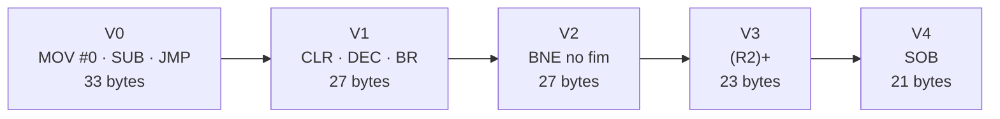

<h1 align="center">🖥️ Computador Cesar</h1>
<p align="center"><b>Programação em linguagem de montagem com o montador Daedalus</b></p>

<p align="center">
  
  
  
  
</p>

<p align="center">
  <b>Gabriel Cabral Wallendzu</b> · HT3080251<br>
  Sistemas de Computação 1 de Automação · Prof. Carlos Eduardo Pagani<br>
  IFSP – Câmpus Hortolândia · 2026
</p>

---

## 📑 Sumário

[Sobre](#-sobre-o-projeto) · [Cesar em 1 minuto](#-cesar-em-1-minuto) · [Programas](#-programas) · [Como executar](#%EF%B8%8F-como-executar) · [Testes](#-testes-realizados) · [Big endian](#-nota-sobre-o-simulador-big-endian) · [Tarefas](#-divisão-das-tarefas) · [Estrutura](#-estrutura-do-repositório)

---

## 🎯 Sobre o projeto

Resolução do laboratório **"Computador Cesar"**: comparação com o Ramses, uma soma de *n* posições refinada em cinco versões, exercícios sobre vetores, bits e 32 bits, uso de **visor e teclado** e um **trabalho avaliativo** que exibe nome, RA e um prompt `>` esperando a resposta **S/N**.

> 📄 O relatório completo (com explicações, tabelas de endereços e testes) acompanha este repositório.

---

## ⚡ Cesar em 1 minuto

| | |
|---|---|
| 🧮 **Dados e endereços** | 16 bits, complemento de dois, *big endian* |
| 🗄️ **Memória** | 64 KB organizada em bytes |
| 🔢 **Registradores** | `R0`–`R5` uso geral · `R6` = SP · `R7` = PC |
| 🚩 **Flags** | `N` negativo · `Z` zero · `C` carry · `V` overflow |
| 📍 **Endereçamento** | 8 modos (registrador, pós-incrementado, pré-decrementado, indexado e versões indiretas) + imediato, absoluto e relativo |
| ⌨️ **Periféricos** | Visor de 36 caracteres e teclado, mapeados em memória |

### Mapa de memória usado nos programas

| Região | Endereços | Uso |
|---|---|---|
| 🟦 **Programa** | `0` a `1023` | Código (`org 0`) |
| 🟩 **Dados** | `1024` em diante | Variáveis e vetores (`org 1024`) |
| 🟨 **Teclado** | `65498` e `65499` | Estado (128 = tecla) e código ASCII |
| 🟥 **Visor** | `65500` a `65535` | 36 caracteres |

---

## 📦 Programas

Cada programa tem 3 arquivos: o **código** (`.ced`) e os arquivos gerados na montagem (`.mem`, `.map`).

### 🔁 Soma de *n* posições: do Ramses ao Cesar

Mesmo algoritmo em cinco versões, cada uma usando mais recursos do Cesar:



Tamanho do programa (1 bloco = 1 byte):

```
V0  █████████████████████████████████  33
V1  ███████████████████████████        27
V2  ███████████████████████████        27
V3  ███████████████████████            23
V4  █████████████████████              21
```

| Versão | Mudança principal | Instruções por volta | Arquivos |
|---|---|---|---|
| **V0** | Tradução direta do Ramses | 5 | [`Soma-V0-Cesar.ced`](Codigos%20Cesar/Soma-V0-Cesar.ced) · [`Soma-V0-Cesar.mem`](Codigos%20Cesar/Soma-V0-Cesar.mem) · [`Soma-V0-Cesar.map`](Codigos%20Cesar/Soma-V0-Cesar.map) |
| **V1** | `CLR`, `DEC` e `BR` (instruções mais curtas) | 5 | [`Soma-V1-Cesar.ced`](Codigos%20Cesar/Soma-V1-Cesar.ced) · [`Soma-V1-Cesar.mem`](Codigos%20Cesar/Soma-V1-Cesar.mem) · [`Soma-V1-Cesar.map`](Codigos%20Cesar/Soma-V1-Cesar.map) |
| **V2** | Teste de zero fora do laço e `BNE` no final | 4 | [`Soma-V2-Cesar.ced`](Codigos%20Cesar/Soma-V2-Cesar.ced) · [`Soma-V2-Cesar.mem`](Codigos%20Cesar/Soma-V2-Cesar.mem) · [`Soma-V2-Cesar.map`](Codigos%20Cesar/Soma-V2-Cesar.map) |
| **V3** | Endereçamento pós-incrementado `(R2)+` | 4 | [`Soma-V3-Cesar.ced`](Codigos%20Cesar/Soma-V3-Cesar.ced) · [`Soma-V3-Cesar.mem`](Codigos%20Cesar/Soma-V3-Cesar.mem) · [`Soma-V3-Cesar.map`](Codigos%20Cesar/Soma-V3-Cesar.map) |
| **V4** | Instrução `SOB` faz contagem e desvio | 2 | [`Soma-V4-Cesar.ced`](Codigos%20Cesar/Soma-V4-Cesar.ced) · [`Soma-V4-Cesar.mem`](Codigos%20Cesar/Soma-V4-Cesar.mem) · [`Soma-V4-Cesar.map`](Codigos%20Cesar/Soma-V4-Cesar.map) |

### 📚 Exercícios resolvidos do laboratório

| Programa | O que faz | Arquivos |
|---|---|---|
| ➕ **Soma de 32 bits** | Soma duas variáveis de 32 bits propagando o carry com `ADC` | [`Soma32-Cesar.ced`](Codigos%20Cesar/Soma32-Cesar.ced) · [`Soma32-Cesar.mem`](Codigos%20Cesar/Soma32-Cesar.mem) · [`Soma32-Cesar.map`](Codigos%20Cesar/Soma32-Cesar.map) |
| 📋 **Mover bloco** | Copia *n* palavras e escolhe o sentido da cópia quando há sobreposição | [`Mover_Blocos-Cesar.ced`](Codigos%20Cesar/Mover_Blocos-Cesar.ced) · [`Mover_Blocos-Cesar.mem`](Codigos%20Cesar/Mover_Blocos-Cesar.mem) · [`Mover_Blocos-Cesar.map`](Codigos%20Cesar/Mover_Blocos-Cesar.map) |
| 🔎 **Pesquisa em vetor** | Maior valor do vetor e sua posição relativa | [`Pesquisa_em_Vetor-Cesar.ced`](Codigos%20Cesar/Pesquisa_em_Vetor-Cesar.ced) · [`Pesquisa_em_Vetor-Cesar.mem`](Codigos%20Cesar/Pesquisa_em_Vetor-Cesar.mem) · [`Pesquisa_em_Vetor-Cesar.map`](Codigos%20Cesar/Pesquisa_em_Vetor-Cesar.map) |
| ⌨️ **Teclado e visor** | Lê o teclado e exibe cada caractere no visor | [`Teclado-Cesar.ced`](Codigos%20Cesar/Teclado-Cesar.ced) · [`Teclado-Cesar.mem`](Codigos%20Cesar/Teclado-Cesar.mem) · [`Teclado-Cesar.map`](Codigos%20Cesar/Teclado-Cesar.map) |

### ✏️ Exercícios propostos

| Exercício | O que faz | Arquivos |
|---|---|---|
| **1** | Posição de um valor (ASCII) em um vetor (`0` se não achar) | [`Exercício1-Cesar.ced`](Codigos%20Cesar/Exerc%C3%ADcio1-Cesar.ced) · [`Exercício1-Cesar.mem`](Codigos%20Cesar/Exerc%C3%ADcio1-Cesar.mem) · [`Exercício1-Cesar.map`](Codigos%20Cesar/Exerc%C3%ADcio1-Cesar.map) |
| **2** | Inicializa um vetor com um valor em memória | [`Exercício2-Cesar.ced`](Codigos%20Cesar/Exerc%C3%ADcio2-Cesar.ced) · [`Exercício2-Cesar.mem`](Codigos%20Cesar/Exerc%C3%ADcio2-Cesar.mem) · [`Exercício2-Cesar.map`](Codigos%20Cesar/Exerc%C3%ADcio2-Cesar.map) |
| **3** | Isolar, zerar, ligar e contar bits, com sub-rotinas `JSR`/`RTS` | [`Exercício3-Cesar.ced`](Codigos%20Cesar/Exerc%C3%ADcio3-Cesar.ced) · [`Exercício3-Cesar.mem`](Codigos%20Cesar/Exerc%C3%ADcio3-Cesar.mem) · [`Exercício3-Cesar.map`](Codigos%20Cesar/Exerc%C3%ADcio3-Cesar.map) |

### 🏁 Trabalho avaliativo

Exibe `Gabriel Cabral Wallendzu HT3080251 >` no visor (36 caracteres, a capacidade exata do visor) e espera uma resposta. As teclas **S**, **s**, **N** e **n** encerram o programa; qualquer outra é ignorada.

[`Trabalho_Avaliativo-Cesar.ced`](Codigos%20Cesar/Trabalho_Avaliativo-Cesar.ced) · [`Trabalho_Avaliativo-Cesar.mem`](Codigos%20Cesar/Trabalho_Avaliativo-Cesar.mem) · [`Trabalho_Avaliativo-Cesar.map`](Codigos%20Cesar/Trabalho_Avaliativo-Cesar.map)

---

## ▶️ Como executar

1. 🛠️ Abra o **Daedalus** e escolha **Máquina Alvo = Cesar**.
2. 📂 Abra o arquivo `.ced` desejado (ou cole o código no **Código Fonte**).
3. 🔨 Clique em **montar**. O Daedalus gera o `.mem` e o `.map`.
4. 🖥️ Abra o simulador **Cesar**, carregue o programa e execute (contínuo ou passo a passo).
5. ✅ Confira registradores e memória com a tabela de testes abaixo.

---

## ✅ Testes realizados

Todos os programas foram montados no Daedalus e executados no simulador, com registradores e memória conferidos ao final. Os endereços são os das **palavras**.

| Programa | Entradas | Saídas verificadas | Status |
|---|---|---|---|
| Soma de *n* posições (V0 a V4) | n = 5; vetor 10, 20, 30, 40, 50 | `1028` = 150 · `R0` = 150 · `R2` = 1040 | ✅ |
| Soma de 32 bits | var1 = 1:60000 · var2 = 2:10000 | `1032` = 4 · `1034` = 4464 | ✅ |
| Mover bloco | n = 4 · origem 1030 · destino 1034 | `1034` a `1040` = 11, 22, 33, 44 | ✅ |
| Pesquisa em vetor | 12, 17, 23, 15, 8, 27, 26, 37 | `1028` = 37 · `1030` = 8 | ✅ |
| Teclado e visor | Teclas digitadas | Caracteres no visor, em sequência | ✅ |
| Exercício 1 | Vetor A, B, C, D · procurado C | `1030` = 3 | ✅ |
| Exercício 2 | n = 10 · valor 42 | `1032` a `1050` = 42 | ✅ |
| Exercício 3 | Valor 180 | `1026` = 16 · `1028` = 148 · `1030` = 181 · `1032` = 4 | ✅ |
| Trabalho avaliativo | Teclas S, s, N, n e outras | Nome, RA e `>` no visor · encerra com S/N | ✅ |

<details>
<summary><b>🔍 Detalhes do Exercício 3 (manipulação de bits)</b></summary>

<br>

Valor de teste: **180** = `10110100` em binário (bits 2, 4, 5 e 7 ligados).

| Sub-rotina | Operação | Resultado |
|---|---|---|
| `ISOLAR` (bit 4) | máscara `AND` | **16** |
| `ZERAR` (bit 5) | `NOT` da máscara + `AND` | **148** |
| `LIGAR` (bit 0) | máscara `OR` | **181** |
| `CONTAR` | 16 deslocamentos `ASR` + carry | **4** bits ligados |

Parâmetros em registradores: `R0` = valor e `R1` = posição (0 a 15). A sub-rotina auxiliar `MASCARA` é chamada com `JSR R4`, e as principais com `JSR R5`.

</details>

---

## 🔄 Nota sobre o simulador (big endian)

O Cesar guarda cada palavra (`dw`) em **2 bytes**, com o byte mais significativo no endereço menor. O visor de dados do simulador mostra byte a byte, então um valor pequeno aparece no byte **seguinte** ao endereço da palavra:

```
palavra em 1030 = 3

 endereço:   1030   1031
 conteúdo:     0      3     <- o valor 3 aparece no byte 1031
```

---

## 📋 Divisão das tarefas

Trabalho **individual**: todas as tarefas foram realizadas por Gabriel Cabral Wallendzu.

| 📝 A fazer | 🚧 Em andamento | ✅ Concluído |
|---|---|---|
| — | — | Soma de *n* posições (versões 0 a 4) |
| — | — | Exercícios resolvidos: 32 bits, bloco, vetor e teclado |
| — | — | Exercícios 1, 2 e 3 |
| — | — | Trabalho avaliativo (nome, RA e prompt) |
| — | — | Relatório e repositório no GitHub |

---

## 🗂️ Estrutura do repositório

```
.
├── Codigos Cesar/
│   ├── Soma-V0-Cesar.ced · .mem · .map   (V0 a V4)
│   ├── Soma32-Cesar.*
│   ├── Mover_Blocos-Cesar.*
│   ├── Pesquisa_em_Vetor-Cesar.*
│   ├── Teclado-Cesar.*
│   ├── Exercício1-Cesar.*  (1 a 3)
│   └── Trabalho_Avaliativo-Cesar.*
├── Relatorio_Cesar_Daedalus
└── README.md
```

| Extensão | O que é |
|---|---|
| `.ced` | Código-fonte do Daedalus para o Cesar |
| `.mem` | Imagem da memória gerada na montagem |
| `.map` | Mapa de rótulos e endereços |

---

<p align="center"><sub>Gabriel Cabral Wallendzu · HT3080251 · IFSP Hortolândia · 2026</sub></p>
